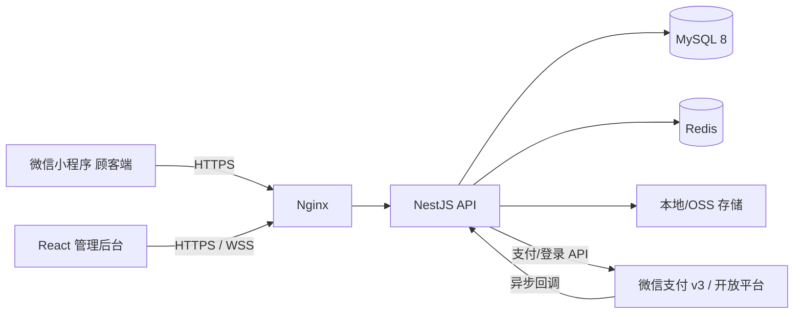

## 用户需求

面向周边自营小商户，打造一套可对外售卖的扫码点单 SaaS 产品，当前交付一个完成度极高的 MVP，后续可直接更换 logo 与主题色交付给不同商户。

## 产品概述

一套"平台方—商户—顾客"三层结构的扫码点单系统。平台方开通并管理商户；商户用手机/电脑管理菜品、桌码与订单；顾客扫桌码进入小程序点单并完成微信支付。系统整体为白标设计，品牌名称、logo、主题色、Banner、公告、客服电话均由后台配置，更换品牌无需改动代码。

## 核心功能

### 顾客端（微信小程序）

- 扫桌码自动识别商户与桌号，无需登录即可浏览菜单下单
- 店铺首页：品牌头图、营业状态、公告、堂食/自取入口、推荐菜
- 菜单点单：左侧分类/右侧商品、规格与加料选择、加购动效、售罄与估清标识、悬浮购物车
- 结算：菜品清单、用餐人数、备注、满减优惠、微信支付
- 支付成功展示取餐号/桌号；订单详情支持状态实时刷新、催单、加菜、未接单取消退款
- 我的订单、手机号一键授权、客服入口
- 骨架屏、空态、断网重试、防重复下单

### 商户端（Web 管理后台）

- 数据看板：今日营业额、订单数、客单价、热销榜
- 订单工作台：新单语音提醒与弹窗、接单/拒单/出餐/完成、桌台账单视图、小票预览、退款
- 菜品管理：分类、商品（图片/价格/规格/加料/排序/上下架/估清）
- 桌码管理：区域与桌号批量创建、小程序码批量生成与下载打印
- 店铺设置：营业时间、公告、打包费、自动接单
- 品牌白标设置：logo、主题色、Banner、文案，手机端实时预览
- 微信支付配置：商户号、APIv3 密钥、证书上传、一键连接测试
- 员工与角色、经营统计（营业额趋势、时段分布、品类占比）

### 平台端

- 商户列表、开通/停用、服务到期时间管理、平台总览数据

## 视觉与交付要求

顾客端视觉温暖、高级、有食欲感，动效流畅；后台干净专业、信息密度高、操作路径短。整套产品默认品牌可一键替换，交付即可上线。

## 技术选型

- 仓库：pnpm workspace monorepo（apps/api、apps/admin、apps/miniprogram、packages/shared）
- 后端：NestJS 11 + TypeScript + Prisma + MySQL 8 + Redis 7 + Socket.IO
- 后台：React 19 + Vite + TDesign React + ECharts
- 小程序：微信原生小程序 + TypeScript（不引入 Taro，降低白标发布与构建复杂度）
- 部署：Docker Compose（mysql + redis + api + nginx），Nginx 托管后台静态资源、上传文件与 WebSocket 升级
- 图片：本地磁盘 + Sharp 压缩 WebP，抽象 StoragePort 接口预留 OSS

## 实现方案

### 总体策略

先固化"数据模型 + 租户隔离 + 订单状态机"三个骨架，再并行推进小程序点单主链路与后台运营链路，最后接入微信登录/支付并打包部署。所有金额以整数分存储，服务端强制重算，客户端金额仅作展示。

### 多租户隔离

所有业务表带 `tenant_id`（高频表同时带 `store_id`，为后续连锁预留）。通过 Prisma Client Extension 在查询层强制注入租户条件，配合 NestJS 的 `TenantGuard` 从 JWT 注入 `tenantId/role`，禁止控制器裸查库。JWT 载荷：`{ sub, tenantId, role, storeId }`；平台角色 `tenantId` 为空但可跨租户读取，业务角色越权统一 403。

### 白标机制（核心）

1. 运行时拉取：小程序启动先请求 `/api/client/bootstrap?tenantCode=&tableNo=`，返回品牌配置（logo、主色、Banner、公告、客服电话、版权）写入全局 store，并通过 `wx.setNavigationBarColor` + 根节点 CSS 变量 `--brand-primary` 生效，改色改 logo 无需发版。
2. 编译期注入：`scripts/brand-set.mjs` 生成 `config/tenant.generated.ts`，支持"一商户一独立小程序主体"批量发布；同时支持单平台小程序用 `scene` 携带 tenantCode 聚合多商户，两种模式共用同一后端。
3. 小程序内禁止硬编码颜色，全部使用 `var(--brand-*)`；后台品牌设置页内置手机壳实时预览组件，所见即所得。

### 微信支付（多商户，最高风险点）

自研 `WechatPayV3Client`（约 300 行，避免第三方库维护风险）：

- 请求签名：商户私钥 RSA-SHA256 生成 Authorization
- 应答/回调验签：拉取 `/v3/certificates` 并用 apiV3Key 解密平台证书，缓存 Redis 12h
- 回调资源：AES-256-GCM 解密；按 URL 中 tenantCode 路由到对应商户配置
- 流程：JSAPI 下单 → 返回签名参数给小程序 `wx.requestPayment` → 回调验签 → 校验金额与 mchid → 幂等置为已支付
- 商户私钥与 apiV3Key 使用 AES-256-GCM 加密入库（主密钥来自环境变量），后台仅可上传/替换，接口永不回显明文
- 提供"连接测试"（查询商户余额/下单探测）与结构化错误码翻译，覆盖商户最常见填错场景
- 退款：原路退款 + 退款回调，未接单可一键退款；微信登录按租户 appId/appSecret 调 jscode2session；手机号用 getPhoneNumber code 换绑

### 关键数据模型

tenant（含到期/状态）、tenant_brand、store、staff_user、payment_config、dining_table、category、product、spec_group、spec_option、customer、order、order_item、refund、audit_log。
订单状态机：`UNPAID → PENDING(待接单) → PREPARING(制作中) → READY(待取/待上) → COMPLETED`，旁支 `CANCELLED`、`REFUNDING → REFUNDED`；状态流转集中在 `order-state.machine.ts`，非法流转抛业务异常并落库审计。

### 性能与可靠性

- 菜单聚合接口按租户缓存 Redis 60s，菜单变更主动失效；订单列表分页 + 复合索引 `(tenant_id, status, created_at)`
- 统计接口 SQL 聚合 + 60s 缓存，避免实时全表扫描
- 下单接口 `Idempotency-Key` 头 + Redis 5 分钟锁；支付回调以 `transaction_id` 唯一索引 + Redis 去重双重幂等
- 小程序码用 `wxacode.getUnlimited` 生成后落盘复用，规避接口调用次数限制
- 新单提醒 Socket.IO 房间 `tenant:{id}`，断线自动降级为 5s 轮询，商户端本地缓存音频指纹避免重复播放

### 安全与合规

bcrypt 密码哈希、登录与下单接口限流、上传类型/大小校验、SQL 全部走 Prisma 参数化、敏感配置加密存储、价格变更与退款写审计日志。上线检查项：域名备案与 HTTPS、小程序服务器域名白名单（request/uploadFile/downloadFile/socket）、餐饮类目资质、隐私协议与用户信息授权说明。

### 系统架构

## 设计定位

双端一体化白标设计系统：小程序端温暖、食欲感强、动效细腻；后台端冷静、专业、信息密度高。两端共用同一套品牌主色与圆角、阴影规范，换主色即整体焕新。

## 设计风格

小程序：新中式暖调 + 现代卡片流。奶油底色、番茄橙主色、圆角 20px 大卡片、柔光投影、图片优先；关键操作用弹性缩放与底部抽屉滑入动画，加购有飞入购物车微动效。后台：轻玻璃拟态侧边栏 + 纯白内容区、8px 栅格、细分隔线，状态用彩色胶囊标签，数据卡片带渐变高光。

## 页面设计

### 小程序 · 店铺首页

顶部沉浸式品牌头图（logo 与店名叠加半透明遮罩），下方悬浮营业状态与桌号卡片；中部公告横滑条与"堂食/自取"双入口大按钮；推荐菜双列卡片带价格与加购按钮；底部固定"开始点单"胶囊按钮与我的订单入口。

### 小程序 · 点单页

左侧 88px 竖排分类导航（选中态左侧橙色竖条），右侧商品卡片流：图、名、描述、销量、规格标签、价格与圆形加购键；售罄图蒙灰加"售罄"角标；点击多规格商品从底部弹出规格面板（规格必选校验、加料多选、数量步进、实时合计）；底部悬浮购物车条显示件数、合计与结算按钮，点开为购物车抽屉。

### 小程序 · 结算与支付结果

结算页顶部桌号/自取切换，菜品清单按行折叠，中部用餐人数与备注输入，底部优惠与合计明细常驻；支付成功页大面积品牌色留白，居中大号取餐号，下方状态时间轴与"查看订单/继续加菜"双按钮。

### 后台 · 登录与数据看板

左侧品牌渐变插画，右侧极简登录卡；看板顶部四张指标卡（今日营业额带环比箭头、订单数、客单价、待接单数），中部营业额折线图与热销 Top5 排行，右侧实时新单流与"今日营业中"开关。

### 后台 · 订单工作台

顶部状态 Tab 带数量角标，主体为订单卡片瀑布流（桌号大字、菜品摘要、金额、等待时长渐变色）；卡片右侧操作按钮组随状态变化；点击展开右侧抽屉显示小票样式详情与退款入口；新单时整屏边缘呼吸光 + 语音播报。

### 后台 · 品牌白标设置

左侧表单分组（logo 上传拖拽区、主题色取色器与预设色板、Banner 多图、文案与客服电话），右侧固定 375px 手机壳实时预览，修改即时联动，底部"保存并同步到小程序"。

## Agent Extensions

### Skill

- **playwright-cli**
- Purpose: 对管理后台执行浏览器冒烟验证，覆盖登录、菜品新增、订单接单、品牌设置等关键页面
- Expected outcome: 产出关键页面截图与流程通过记录，确认后台无白屏、无控制台报错